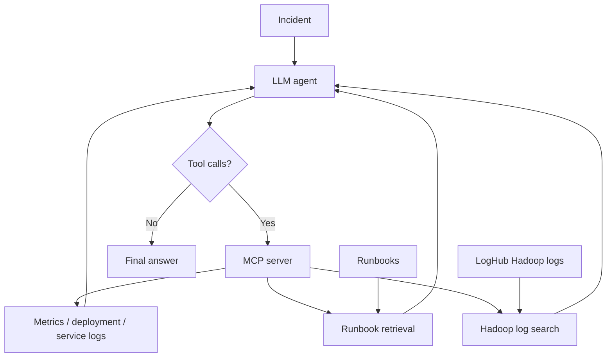

# Agentic Incident Response

An LLM-based agent for investigating and diagnosing system incidents through iterative tool calling and retrieval. The agent uses MCP to access logs, service metrics, deployment information and troubleshooting runbooks, deciding which evidence to retrieve as the investigation progresses.

The project covers two incident investigation scenarios: a simulated API failure and failure classification using real-world Hadoop logs from the LogHub dataset, comprising approximately 20 million tokens. The Hadoop experiments evaluate how different retrieval methods and context management strategies affect classification performance using Qwen3-8B.

## How it works

The agent uses native tool calling to investigate incidents iteratively. Tool definitions are discovered through MCP and passed to the model using JSON Schema. Tool results are added to the conversation until the model returns a final answer. A persistent MCP session reuses the same server process throughout each run.

## Current tools

The Hadoop retrieval tool exposed through MCP depends on the evaluation version. The implementations are retained for comparison.

- `get_metrics()` — simulated latency, GPU utilization and queue length.
- `get_deployment()` — latest deployment and configuration changes.
- `get_logs(service, limit)` — simulated API, worker or database logs.
- `search_runbooks(query, top_k=3)` — embedding search over troubleshooting runbooks.
- `search_logs(application_id, query, limit=20, start_line=1)` — literal substring search, with source file and line numbers.
- `search_logs_bm25_v1(application_id, query, limit=20)` — BM25 over individual log lines.
- `search_logs_bm25_v2(application_id, query, limit=5, chunk_size=50, overlap=10)` — BM25 over consecutive log chunks, returning up to five chunks with source files and line ranges.

## RAG

Runbook retrieval is exposed as an MCP tool rather than invoked automatically. Runbooks are chunked and embedded using SentenceTransformers; cosine similarity ranks the top-k chunks. Chunks and embeddings are cached in memory after the first retrieval.

## Hadoop logs

The agent searches application logs through MCP rather than receiving the full logs in context. The labeled LogHub Hadoop dataset covers Normal, Machine down, Network disconnection and Disk full. The smaller `Hadoop_2k` sample is used for development and debugging.

## Evaluation

Qwen3-8B is evaluated on 55 labeled LogHub Hadoop applications (11 Normal, 28 Machine down, 7 Network disconnection, 9 Disk full). The first three versions use five runs each; v2.3 and v2.4 currently use one run each. Output-token budgets and context management changed during development, so differences cannot be attributed to retrieval alone.

### Retrieval versions

- **v1:** Case-insensitive literal substring search.
- **v2.1:** BM25 over individual log lines.
- **v2.2:** BM25 over 50-line chunks with 10-line overlap, at most five chunks per search. Older tool responses are shortened in model context but retained locally; output limit: 6,000 tokens.
- **v2.3:** v2.2 with few-shot prompting.
- **v2.4:** v2.3 with revised context management.
- **v3:** Embedding search with cosine similarity (planned).
- **v4:** Embedding search + reranker (planned).

### Overall results

| Version | Runs | Accuracy | Macro F1 | Weighted F1 |
| --- | ---: | ---: | ---: | ---: |
| v1 | 5 | 31.3% | 0.346 | 0.256 |
| v2.1 | 5 | 30.2% | 0.333 | 0.257 |
| v2.2 | 5 | 28.7% | 0.329 | 0.216 |
| v2.3 | 1 | 58.2% | 0.570 | 0.598 |
| v2.4 | 1 | **69.1%** | **0.671** | **0.705** |

Majority-class baseline: 50.9% accuracy (always predicting Machine down).

### Per-class results

Each cell shows **recall (%) / F1**. F1 is reported as zero for classes with no predictions.

| Version | Normal | Machine down | Network disconnection | Disk full |
| --- | ---: | ---: | ---: | ---: |
| v1 | 70.9 / 0.341 | 5.0 / 0.095 | 68.6 / 0.425 | 35.6 / 0.525 |
| v2.1 | 50.9 / 0.322 | 6.4 / 0.116 | 77.1 / 0.360 | 42.2 / 0.535 |
| v2.2 | 52.7 / 0.343 | 0.0 / 0.000 | 77.1 / 0.316 | 51.1 / 0.657 |
| v2.3 | 63.6 / 0.519 | 50.0 / 0.651 | 85.7 / 0.522 | 55.6 / 0.588 |
| v2.4 | 63.6 / 0.609 | 64.3 / 0.766 | 85.7 / 0.571 | 77.8 / 0.737 |

Multi-line retrieval alone (v2.2) improved Disk full F1 but reduced overall accuracy (79/275 correct). The model never predicted Machine down. With few-shot prompting (v2.3), accuracy rose to 32/55; revised context management (v2.4) reached 38/55. Machine down and Disk full recall improved, but seven Machine down cases were still classified as Network disconnection. More runs and controlled comparisons are needed to confirm these gains.

## Architecture

## Stack

Python · Qwen3-8B · vLLM · RunPod Serverless · MCP · SentenceTransformers · NumPy · requests · LogHub · BM25S

## Next steps

- compare BM25 with embedding search and hybrid retrieval
- add a reranker and repeat the evaluation
- evaluate context-management trade-offs, accuracy, per-class metrics and latency across versions
