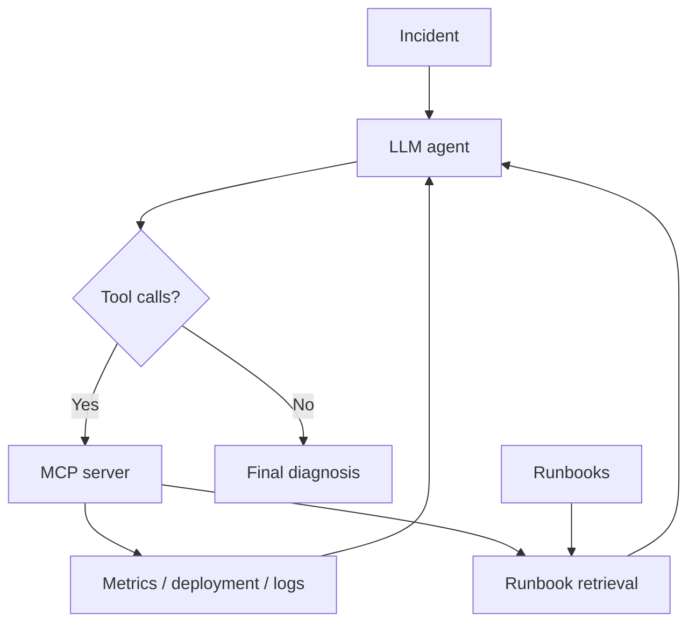

# Agentic Incident Response

A small project for learning how LLM agents, tool calling, MCP and RAG work under the hood.

The project simulates a software incident where an API service becomes slow and starts returning errors. The agent can inspect metrics, deployment changes and service logs, retrieve relevant troubleshooting guidance, and use the collected evidence to diagnose the problem.

## How it works

The agent investigation loop is:

```text
incident
   ↓
LLM decides which tools to call
   ↓
MCP executes the selected tools
   ↓
tool results are added to the conversation
   ↓
LLM continues investigating or gives a final diagnosis
```

The agent uses native tool calling and can request multiple tools in the same response. Tool definitions are discovered dynamically through MCP and exposed to the model using JSON Schema.

A persistent MCP session is kept open during the agent run so tool calls reuse the same server process. A maximum iteration limit prevents the agent from looping indefinitely.

## Current tools

`get_metrics()`

Returns simulated service metrics such as latency, GPU utilization and queue length.

`get_deployment()`

Returns information about the latest deployment and configuration changes.

`get_logs(service, limit)`

Reads log data for a selected service and returns the most recent log entries.

`search_runbooks(query, top_k=3)`

Searches incident-response runbooks and returns the most relevant chunks for the agent.

## Agentic RAG

Runbook retrieval is exposed through MCP as a tool. The agent decides when documentation is useful instead of always retrieving before generation.

Documents are split into overlapping chunks, embedded with SentenceTransformers, ranked against the query using cosine similarity, and returned as top-k results. The embedding model is loaded lazily only when retrieval is first needed.

```text
incident
   ↓
agent investigates
   ↓
search_runbooks when useful
   ↓
embedding + retrieval
   ↓
top-k runbook chunks
   ↓
agent continues investigation
```

## Architecture



## Stack

- Python
- Qwen3-8B
- vLLM
- RunPod Serverless
- MCP
- SentenceTransformers
- NumPy
- requests

## Next steps

- cache document chunks and embeddings
- add multiple incident scenarios
- evaluate retrieval, tool use and diagnosis quality
- test whether the agent distinguishes evidence from hypotheses
- measure latency, token usage and retrieval settings
