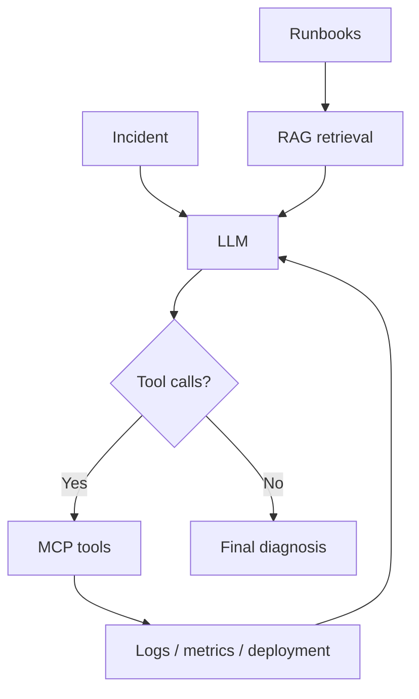

# Agentic Incident Response

A small project for learning how LLM agents, tool calling, MCP and RAG work under the hood.

The project simulates a software incident where an API service becomes slow and starts returning errors. The agent can inspect metrics, deployment changes and service logs, retrieve relevant troubleshooting guidance, and use the collected evidence to diagnose the problem.

## How it works

The agent investigation loop is:

```text
incident
   ↓
LLM decides which tools to call
   ↓
MCP executes the selected tools
   ↓
tool results are added to the conversation
   ↓
LLM continues investigating or gives a final diagnosis
```

The agent uses native tool calling and can request multiple tools in the same response. Tool definitions are discovered through MCP and exposed to the model using JSON Schema.

A maximum iteration limit prevents the agent from looping indefinitely.

## Current tools

`get_metrics()`

Returns simulated service metrics such as latency, GPU utilization and queue length.

`get_deployment()`

Returns information about the latest deployment and configuration changes.

`get_logs(service, limit)`

Reads log data for a selected service and returns the most recent log entries.

## RAG

A classic RAG pipeline is implemented over local incident-response runbooks.

Documents are split into overlapping chunks, embedded with SentenceTransformers, ranked against the query using cosine similarity, and the top-k chunks are added to the LLM context before generation.

```text
query
   ↓
embedding + retrieval
   ↓
top-k runbook chunks
   ↓
augmented prompt
   ↓
LLM answer
```

## Architecture



## Stack

- Python
- Qwen3-8B
- vLLM
- RunPod Serverless
- MCP
- SentenceTransformers
- NumPy
- requests

## Next steps

- expose runbook retrieval as an MCP tool
- let the agent decide when documentation should be retrieved
- add multiple incident scenarios
- evaluate retrieval, tool use and diagnosis quality
- measure latency, token usage and retrieval settings
