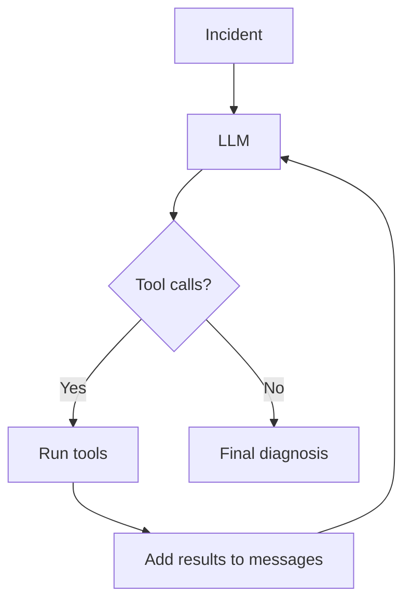

# Agentic Incident Response

A small project for learning how LLM agents work under the hood.

The project simulates a software incident where a service became slow after a deployment. The LLM can inspect system information using tools and use the results to diagnose the problem.

## How it works

The basic loop is:

```text
incident
   ↓
LLM decides which tools to call
   ↓
Python executes the tools
   ↓
tool results are added to the conversation
   ↓
LLM continues or gives a final diagnosis
```

The agent uses native tool calling and can request multiple tools in the same response. The loop continues until the model returns a normal answer instead of another tool call.

A maximum iteration limit prevents the agent from looping indefinitely.

## Current tools

`get_metrics()`

Returns simulated service metrics such as latency, GPU utilization and queue length.

`get_deployment()`

Returns information about the latest deployment and configuration changes.

## Architecture



## Stack

- Python
- Qwen3-8B
- vLLM
- RunPod Serverless
- requests

## Next steps

- more realistic tools, such as logs
- MCP
- RAG over runbooks and incident documentation
- evaluation of tool use and diagnosis quality
- latency and token usage measurements
