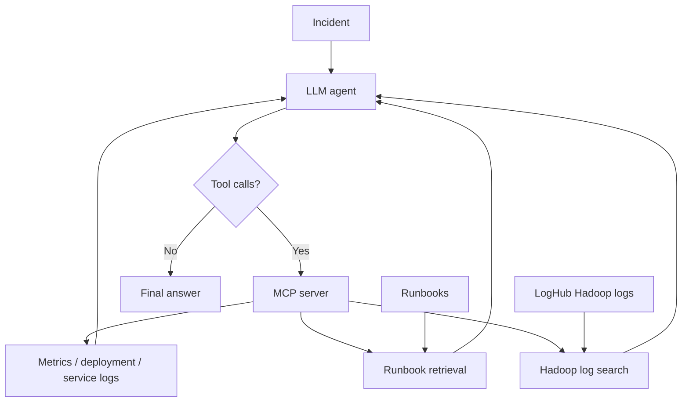

# Agentic Incident Response

A small project for experimenting with LLM agents, tool calling, MCP and retrieval for incident investigation.

The project started with a synthetic API incident and later added real Hadoop logs from LogHub. The agent can inspect logs, metrics, deployment information and runbooks through MCP tools and use that information to classify or diagnose incidents.

## How it works

```text
incident
   ↓
LLM decides which tools to call
   ↓
MCP executes the tools
   ↓
results are added to the conversation
   ↓
LLM continues investigating or returns a final answer
```

The agent uses native tool calling. Tool definitions are discovered through MCP and passed to the model using JSON Schema.

A persistent MCP session is kept open during each agent run so the same server process can be reused across tool calls.

## Current tools

The Hadoop retrieval tool exposed through MCP depends on the evaluation version. The implementations are retained for comparison.

`get_metrics()`

Returns simulated service metrics such as latency, GPU utilization and queue length.

`get_deployment()`

Returns information about the latest deployment and configuration changes.

`get_logs(service, limit)`

Reads simulated API, worker or database logs.

`search_runbooks(query, top_k=3)`

Searches troubleshooting runbooks using embeddings and cosine similarity.

`search_logs(application_id, query, limit=20, start_line=1)`

Searches logs for one Hadoop application using a case-insensitive literal substring. Results include source file, line number and matching log row.

`search_logs_bm25_v1(application_id, query, limit=20)`

Ranks individual log lines using BM25. Each line is a separate retrieval document.

`search_logs_bm25_v2(application_id, query, limit=5, chunk_size=50, overlap=10)`

Ranks consecutive log-line chunks using BM25 and returns the top matching chunks with their source files and line ranges. Retrieval is capped at five chunks per call.

## RAG

Runbook retrieval is exposed as an MCP tool instead of being called automatically before every request.

The current implementation:

```text
runbooks
   ↓
chunking
   ↓
SentenceTransformer embeddings
   ↓
cosine similarity
   ↓
top-k chunks
```

Chunks and embeddings are cached in memory after the first retrieval.

## Hadoop logs

The project uses the labeled LogHub Hadoop dataset for evaluation.

Each application belongs to one of four classes:

- Normal
- Machine down
- Network disconnection
- Disk full

The agent does not receive the full application logs in its context. It searches them through an MCP log-retrieval tool and decides what to inspect.

The smaller `Hadoop_2k` sample is still useful for development and debugging.

## Evaluation

The benchmark uses 55 labeled Hadoop applications (11 Normal, 28 Machine down, 7 Network disconnection and 9 Disk full). Each retrieval setup is evaluated over five runs, for 275 classifications per version, using Qwen3-8B.

The experiments are not perfectly controlled: the output-token budget and context-management behavior changed during development. Differences in accuracy therefore cannot be attributed to retrieval alone.

### v1 — Literal substring search

Case-insensitive matching against individual log lines.

### v2.1 — BM25 (one log line per document)

BM25 ranks individual lines instead of relying on exact substring matches.

### v2.2 — BM25 (multi-line chunks)

BM25 ranks chunks of up to 50 consecutive log lines, with a 10-line overlap between chunks from the same file. The agent receives at most five chunks per search. Older tool responses are shortened when preparing the model context, while the original tool outputs remain available in the local conversation history. This version uses a 6,000-token output limit.

#### Results across five runs

| Metric | Literal search | BM25 v2.1 | BM25 v2.2 |
| --- | ---: | ---: | ---: |
| Accuracy | 31.3% | 30.2% | 28.7% |
| Macro F1 | 0.346 | 0.333 | 0.329 |
| Weighted F1 | 0.256 | 0.257 | 0.216 |

| Class | Literal recall | BM25 v2.1 recall | BM25 v2.2 recall | Literal F1 | BM25 v2.1 F1 | BM25 v2.2 F1 |
| --- | ---: | ---: | ---: | ---: | ---: | ---: |
| Normal | 70.9% | 50.9% | 52.7% | 0.341 | 0.322 | 0.343 |
| Machine down | 5.0% | 6.4% | 0.0% | 0.095 | 0.116 | 0.000 |
| Network disconnection | 68.6% | 77.1% | 77.1% | 0.425 | 0.360 | 0.316 |
| Disk full | 35.6% | 42.2% | 51.1% | 0.525 | 0.535 | 0.657 |

BM25 v2.2 achieved **79/275 correct classifications**. Per-run accuracy was **25.5%, 30.9%, 29.1%, 29.1% and 29.1%**.

The model never predicted **Machine down** in v2.2, despite that class accounting for 28 of the 55 applications. It often confused Machine down with Network disconnection or Normal. Disk full F1 improved, but overall accuracy declined relative to the previous retrieval setups. This suggests that retrieving longer passages alone does not resolve the underlying classification problem.

As a simple reference point, always predicting the majority class (Machine down) would achieve **50.9% accuracy** on this dataset. Future evaluation should include simple rule-based baselines and closer error analysis. For classes with no predictions, F1 is reported as 0.

### v3 — Embedding search

Use vector embeddings and cosine similarity to retrieve semantically related log lines or chunks.

Evaluation: **not run yet**

### v4 — Embedding search + reranker

Use embedding search to retrieve candidates, then rerank them before returning the final results to the agent.

Evaluation: **not run yet**

## Architecture



## Stack

- Python
- Qwen3-8B
- vLLM
- RunPod Serverless
- MCP
- SentenceTransformers
- NumPy
- requests
- LogHub
- BM25S

## Next steps

- inspect Machine down failure cases and distinguish network symptoms from root causes
- evaluate a simple rule-based baseline alongside the LLM agent
- test few-shot prompting with examples that do not overlap with evaluated applications
- compare BM25 with embedding search and hybrid retrieval
- add a reranker and repeat the evaluation
- evaluate context-management trade-offs, accuracy, per-class metrics and latency across versions
