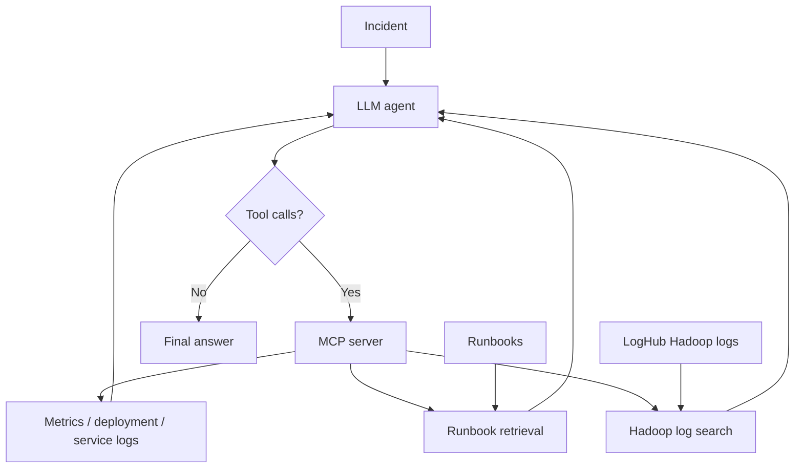

# Agentic Incident Response

A small project for experimenting with LLM agents, tool calling, MCP and retrieval for incident investigation.

The project started with a synthetic API incident and later added real Hadoop logs from LogHub. The agent can inspect logs, metrics, deployment information and runbooks through MCP tools and use that information to classify or diagnose incidents.

## How it works

```text
incident
   ↓
LLM decides which tools to call
   ↓
MCP executes the tools
   ↓
results are added to the conversation
   ↓
LLM continues investigating or returns a final answer
```

The agent uses native tool calling. Tool definitions are discovered through MCP and passed to the model using JSON Schema.

A persistent MCP session is kept open during each agent run so the same server process can be reused across tool calls.

## Current tools

`get_metrics()`

Returns simulated service metrics such as latency, GPU utilization and queue length.

`get_deployment()`

Returns information about the latest deployment and configuration changes.

`get_logs(service, limit)`

Reads simulated API, worker or database logs.

`search_runbooks(query, top_k=3)`

Searches troubleshooting runbooks using embeddings and cosine similarity.

`search_logs(application_id, query, limit=20, start_line=1)`

Searches logs for one Hadoop application using a case-insensitive literal substring. Results include source file, line number and matching log row.

## RAG

Runbook retrieval is exposed as an MCP tool instead of being called automatically before every request.

The current implementation:

```text
runbooks
   ↓
chunking
   ↓
SentenceTransformer embeddings
   ↓
cosine similarity
   ↓
top-k chunks
```

Chunks and embeddings are cached in memory after the first retrieval.

## Hadoop logs

The project uses the labeled LogHub Hadoop dataset for evaluation.

Each application belongs to one of four classes:

- Normal
- Machine down
- Network disconnection
- Disk full

The agent does not receive the full application logs in its context. It searches them through `search_logs` and decides what to inspect.

The smaller `Hadoop_2k` sample is still useful for development and debugging.

## Evaluation

The benchmark uses 55 labeled Hadoop applications. Each setup is run five times with the same model settings and prompt (275 classifications per version).

### v1 — Literal substring search

### v2.1 — BM25 (one log line per document)

| Metric | Literal search | BM25 v1 |
| --- | ---: | ---: |
| Accuracy | 31.3% | 30.2% |
| Macro F1 | 0.346 | 0.333 |
| Weighted F1 | 0.256 | 0.257 |

| Class | Literal Recall | BM25 Recall | Literal F1 | BM25 F1 |
| --- | ---: | ---: | ---: | ---: |
| Normal | 70.9% | 50.9% | 0.341 | 0.322 |
| Machine down | 5.0% | 6.4% | 0.095 | 0.116 |
| Network disconnection | 68.6% | 77.1% | 0.425 | 0.360 |
| Disk full | 35.6% | 42.2% | 0.525 | 0.535 |

### v2.2 — BM25

Use BM25 function to rank lines and return surrounding rows as well instead of requiring an exact substring match.

Evaluation: **not run yet**

### v3 — Embedding search

Use vector embeddings and cosine similarity to retrieve semantically related log lines or chunks.

Evaluation: **not run yet**

### v4 — Embedding search + reranker

Use embedding search to retrieve candidates, then rerank them before returning the final results to the agent.

Evaluation: **not run yet**

## Architecture



## Stack

- Python
- Qwen3-8B
- vLLM
- RunPod Serverless
- MCP
- SentenceTransformers
- NumPy
- requests
- LogHub

## Next steps

- implement BM25 log retrieval
- run the same evaluation with BM25
- compare BM25 with embedding search
- add a reranker and repeat the evaluation
- compare accuracy, per-class metrics and latency across versions
