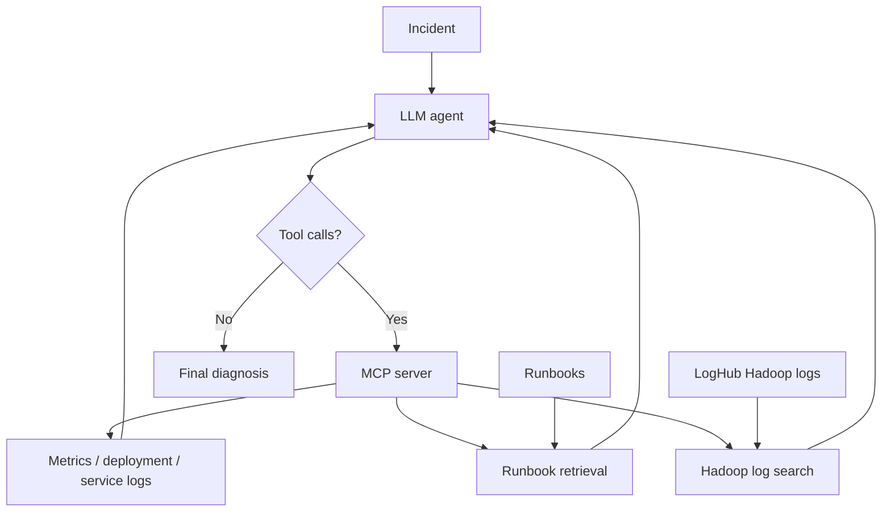

# Agentic Incident Response

A project for learning how LLM agents, tool calling, MCP and RAG work under the hood.

The project started with a simulated software incident where an API service becomes slow and starts returning errors. The agent can inspect metrics, deployment changes and service logs, retrieve relevant troubleshooting guidance, and use the collected evidence to diagnose the problem.

The project now also includes real Hadoop logs from LogHub so the same agent loop can be tested on less controlled data.

## How it works

The agent investigation loop is:

```text
incident
   ↓
LLM decides which tools to call
   ↓
MCP executes the selected tools
   ↓
tool results are added to the conversation
   ↓
LLM continues investigating or gives a final diagnosis
```

The agent uses native tool calling and can request multiple tools in the same response. Tool definitions are discovered dynamically through MCP and exposed to the model using JSON Schema.

A persistent MCP session is kept open during the agent run so tool calls reuse the same server process. A maximum iteration limit prevents the agent from looping indefinitely.

## Current tools

`get_metrics()`

Returns simulated service metrics such as latency, GPU utilization and queue length.

`get_deployment()`

Returns information about the latest deployment and configuration changes.

`get_logs(service, limit)`

Reads simulated log data for a selected API, worker or database service.

`search_runbooks(query, top_k=3)`

Searches incident-response runbooks and returns the most relevant chunks for the agent.

`search_logs(query, limit=20, start_line=1)`

Searches the LogHub Hadoop logs using a case-insensitive literal substring. Results include the source file, line number and matching log row. `start_line` lets the agent continue searching further down the file when the first batch is not enough.

## Agentic RAG

Runbook retrieval is exposed through MCP as a tool. The agent decides when documentation is useful instead of always retrieving before generation.

Documents are split into overlapping chunks, embedded with SentenceTransformers, ranked against the query using cosine similarity, and returned as top-k results. The embedding model is loaded lazily only when retrieval is first needed. Chunks and embeddings are cached in memory during the process.

```text
incident
   ↓
agent investigates
   ↓
search_runbooks when useful
   ↓
embedding + retrieval
   ↓
top-k runbook chunks
   ↓
agent continues investigation
```

## Hadoop logs

The project currently uses the LogHub `Hadoop_2k` sample for development.

Instead of sending the entire log file to the model, the agent searches it through `search_logs`. This keeps the investigation tool-based and lets the model decide what evidence to look for.

In the current test case, the logs contain repeated HDFS and ResourceManager communication errors, followed by `NoRouteToHostException` errors during MapReduce task attempts. The agent can use these log entries to investigate the likely cause of the failure.

The Hadoop files are stored under:

```text
datasets/
└── loghub/
    └── hadoop/
        ├── Hadoop_2k.log
        ├── Hadoop_2k.log_structured.csv
        └── Hadoop_2k.log_templates.csv
```

The raw `.log` file is currently used by the agent. The structured files will be useful later for analysis and evaluation.

## Architecture



## Stack

- Python
- Qwen3-8B
- vLLM
- RunPod Serverless
- MCP
- SentenceTransformers
- NumPy
- requests
- LogHub

## Next steps

- build an evaluation setup for tool use and diagnosis quality
- test multiple runs on the same incident
- evaluate whether the agent distinguishes evidence from hypotheses
- move from the Hadoop 2k sample to the full labeled Hadoop dataset
- add more real incident scenarios
- measure latency, token usage and tool-call behavior
