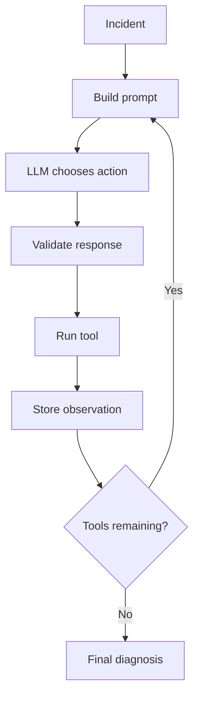

# Agentic Incident Response

A small project for learning how LLM agents work under the hood.

The current version simulates a software incident where a service became slow after a deployment. The LLM can choose between a few simple tools, inspect the returned data, and use the collected observations to produce a diagnosis.

## How it works

The basic loop is:

```text
incident
   ↓
LLM chooses a tool
   ↓
Python validates the choice
   ↓
tool is executed
   ↓
result is stored as an observation
   ↓
LLM chooses the next tool
   ↓
final diagnosis
```

The model currently returns its tool choice as JSON, for example:

```json
{"action": "metrics"}
```

Python then parses and validates the response before executing the corresponding function.

## Current tools

`get_metrics()`

Returns simulated service metrics such as latency, GPU utilization and queue length.

`get_deployment()`

Returns information about the latest deployment and configuration changes.

## Architecture



## Stack

- Python
- Qwen3-8B
- vLLM
- RunPod Serverless
- requests
- JSON

## Next steps

The current JSON-based tool selection is deliberately simple. The next step is to replace it with native tool calling.

After that I plan to add:

- more realistic tools, such as logs
- MCP
- RAG over runbooks / incident documentation
- evaluation of tool selection and diagnosis quality
- latency and token usage measurements
