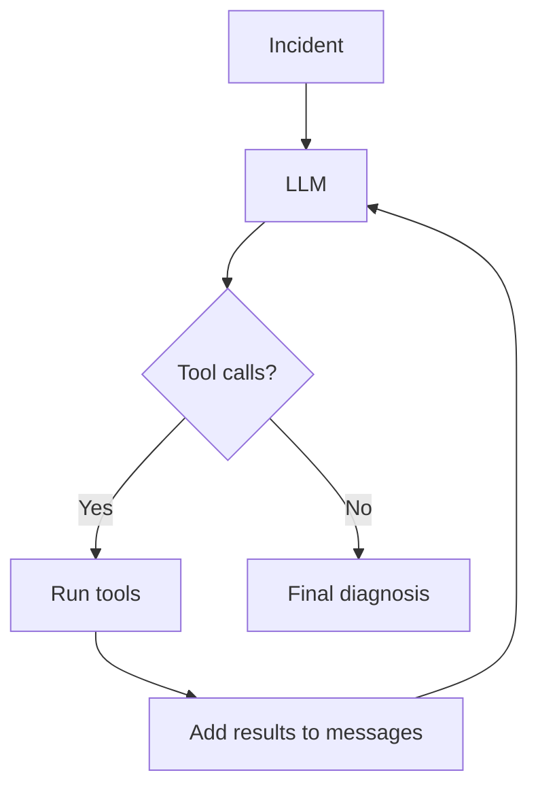

# Agentic Incident Response

A small project for learning how LLM agents work under the hood.

The project simulates a software incident where an API service becomes slow and starts returning errors. The agent can inspect metrics, deployment changes and service logs, then use the collected evidence to diagnose the problem.

## How it works

The basic loop is:

```text
incident
   ↓
LLM decides which tools to call
   ↓
Python executes the tools
   ↓
tool results are added to the conversation
   ↓
LLM continues investigating or gives a final diagnosis
```

The agent uses native tool calling and can request multiple tools in the same response. Tool arguments are defined with JSON Schema, and log tools can inspect different services such as the API, database and worker.

A maximum iteration limit prevents the agent from looping indefinitely.

## Current tools

`get_metrics()`

Returns simulated service metrics such as latency, GPU utilization and queue length.

`get_deployment()`

Returns information about the latest deployment and configuration changes.

`get_logs(service, limit)`

Reads log data for a selected service and returns the most recent log entries.

## Architecture



## Stack

- Python
- Qwen3-8B
- vLLM
- RunPod Serverless
- requests

## Next steps

- MCP
- RAG over runbooks and incident documentation
- evaluation of tool use and diagnosis quality
- latency and token usage measurements
